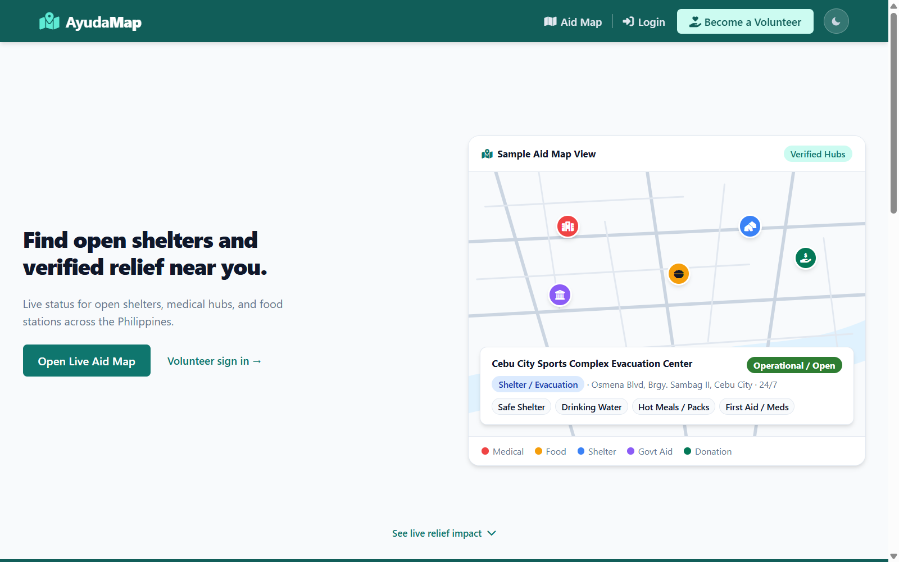
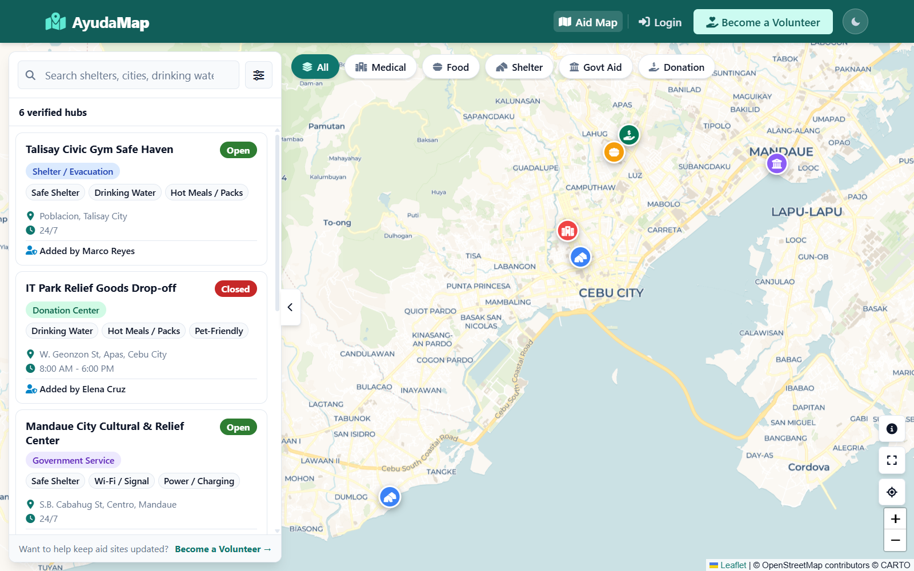
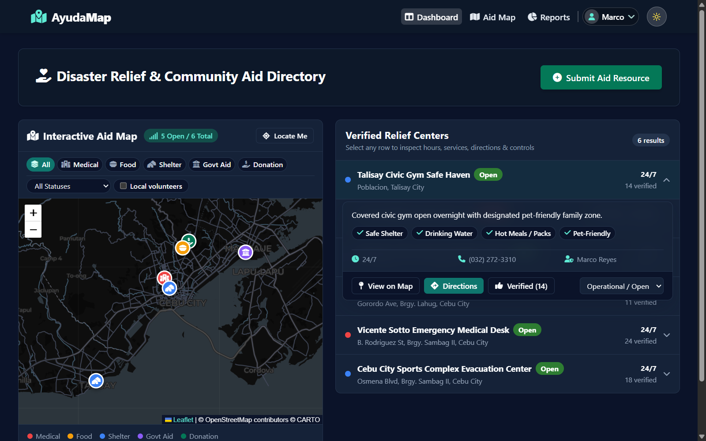
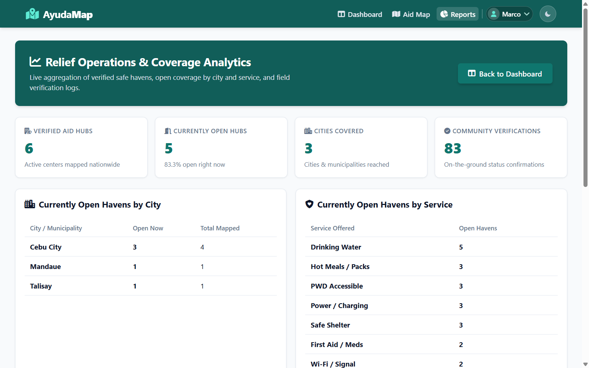
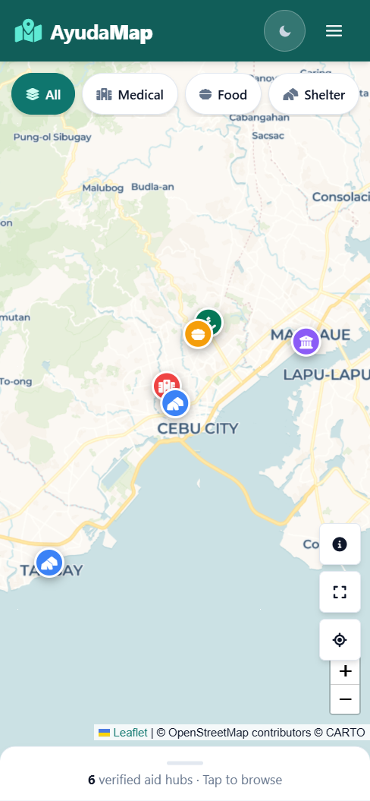

# AyudaMap

**Community Aid & Disaster Relief Platform**

[](https://www.python.org/)
[](https://www.djangoproject.com/)
[](https://supabase.com/)
[](https://leafletjs.com/)

AyudaMap is a Django web application for mapping and coordinating verified community aid resources during disasters and relief operations across the Philippines. Guests can locate open shelters, medical facilities, food hubs, government services, and donation drop-offs with zero sign-up, while field volunteers and coordinators keep operating statuses, service checklists, and audit logs current in real time.

---

## Navigation

[Screenshots](#screenshots) · [Features](#features) · [Tech Stack](#tech-stack) · [Project Structure](#project-structure) · [Quick Start](#quick-start-local-development) · [Configuration](#configuration) · [Testing](#running-the-tests) · [Documentation](#documentation)

---

## Screenshots

### Public Landing Page (`/`)



### Live Aid Map & Dark-Mode Volunteer Dashboard
| Public Live Aid Map (`/map/`) | Volunteer Dashboard — Dark Mode (`/dashboard/`) |
| :---: | :---: |
|  |  |
| Full-viewport Leaflet + CARTO Voyager map with keyword/service search, category chips, and status filter | Split workbench with CARTO Dark Matter tiles, in-place AJAX filters, expanded hub actions, and click-to-pick coordinates |

### Operations Analytics & Mobile Field Experience
| Relief Operations Reports (`/reports/`) | Mobile Public Aid Map (`390×844`) |
| :---: | :---: |
|  |  |
| Live KPIs, open havens by city & service, category breakdown, and field verification audit log | Touch-friendly floating category chips and expandable bottom sheet for field responders |

---

## Features

### Public Discovery (No Sign-Up Required)
- **Live coverage landing (`/`)** — Real-time totals for verified hubs, currently open sites, cities covered, community confirmations, and category coverage bars.
- **Full-viewport aid map (`/map/`)** — Interactive Leaflet map with CARTO basemaps (and automatic OpenStreetMap fallback), category-coded pins, client-side keyword/service search, status filters, pin legend, locate-me, and Google Maps **Directions** links.
- **Verified-only visibility** — Only `is_verified=True` entries appear publicly; internal coordinator notes (`supplies_needed`) remain restricted to Django admin.

### Volunteer Field Operations (`/dashboard/`)
- **In-place AJAX filtering** — Filter by category chip (defaults to user preference), effective operating status (`Operational / Open`, `Crowded / Limited`, `Closed`), and **Local volunteers** (`Subquery` matching volunteers in your canonical Philippine city) with shareable URLs.
- **Safe-haven service tags & operating hours** — Track 8 practical amenities (`Safe Shelter`, `Drinking Water`, `Hot Meals / Packs`, `First Aid / Meds`, `Power / Charging`, `Wi-Fi / Signal`, `PWD Accessible`, `Pet-Friendly`) plus **Open 24/7** or daily `opens_at`/`closes_at` schedules (`Asia/Manila`, including overnight windows) that automatically display as `Closed` after hours.
- **One-tap verification & audit trail** — Add hubs with click-to-pick or GPS coordinates and standardized PSGC-aligned Philippine city choices ([`apps/locations.py`](apps/locations.py)), confirm active sites atomically (`F('confirmations') + 1`), or update operating statuses—each writing a [`ResourceStatusLog`](apps/home/models.py) entry.

### Coordinator Analytics & Accounts
- **Reports dashboard (`/reports/`)** — Live aggregations for open havens by city, open havens by service, aid category breakdowns, and the 15 most recent field audit entries.
- **Volunteer accounts (`/register/`, `/profile/`, `/settings/`)** — Volunteer onboarding, tabbed profile workspace with avatar upload and personal hub/log history, persistent light/dark theme toggle, map center/zoom defaults, and password management.
- **Django admin (`/admin/`)** — Staff management for `Resource` and `ResourceStatusLog`.

---

## Tech Stack

| Layer | Technology |
| --- | --- |
| Backend | Python 3, Django 6.1.1 |
| Database | Supabase PostgreSQL via `DATABASE_URL`; SQLite fallback in debug mode |
| DB drivers / config | `psycopg[binary]` 3.3.9, `dj-database-url` 3.1.2, `python-dotenv` 1.2.3, `sqlparse` 0.6.0 |
| Frontend | Server-rendered Django templates, Leaflet.js 1.9.4, CARTO / OSM tiles, Font Awesome 6.4, vanilla CSS & JS |
| Media & Timezone | Pillow 12.3.0 (profile uploads), `Asia/Manila` (`tzdata` 2026.3) |
| Production WSGI | Gunicorn 27.0.1 (non-Windows) behind an HTTPS reverse proxy |

---

## Project Structure

AyudaMap follows a **vertical-slice** layout where each feature app owns its models, forms, views, URLs, templates, and static assets:

```text
AyudaMap/
├── config/                     # Project settings, root URLs, ASGI/WSGI
├── apps/
│   ├── locations.py            # Shared PSGC-aligned Philippine city choices & normalizer
│   ├── home/                   # Landing, public map, volunteer dashboard, CRUD actions, reports
│   ├── login/                  # Authentication (login / logout)
│   ├── register/               # Volunteer registration (configures Profile + UserSettings)
│   ├── profile/                # User profile, avatar upload, and volunteer activity tabs
│   └── user_settings/          # Theme, map defaults, preferences, and password change
├── templates/                  # Shared base layout + per-app templates
├── static/                     # Favicon, shared tokens/auth CSS, and per-app CSS/JS
├── docs/                       # Architecture, user guide, testing, deployment, and screenshots
├── requirements.txt
└── .env.example                # Environment variable template
```

---

## Quick Start (Local Development)

```powershell
# 1. Create and activate a virtual environment
python -m venv venv
.\venv\Scripts\Activate.ps1          # Windows PowerShell
# source venv/bin/activate          # macOS / Linux

# 2. Install dependencies
pip install -r requirements.txt

# 3. Configure local environment
Copy-Item .env.example .env          # Windows
# cp .env.example .env              # macOS / Linux
# Keep DJANGO_DEBUG=True and leave DATABASE_URL blank to use local SQLite.

# 4. Apply database migrations
python manage.py migrate

# 5. Start the development server
python manage.py runserver
```

- Open <http://127.0.0.1:8000/> for the public landing page, or <http://127.0.0.1:8000/map/> for the full-screen public aid map.
- Click **Become a Volunteer** (`/register/`) to create a volunteer account and access `/dashboard/` and `/reports/`.
- On a fresh database, the map starts empty; submit hubs from `/dashboard/` or create a staff account with `python manage.py createsuperuser` to use `/admin/`.

---

## Configuration

Set configuration via environment variables or a local `.env` file (environment variables take precedence). See [`.env.example`](.env.example).

| Variable | Required | Purpose |
| --- | --- | --- |
| `DJANGO_DEBUG` | No | Defaults to `False`. Set to `True` for local development only. |
| `SECRET_KEY` | With debug off | Django signing key. Use a long, random value in production. |
| `DJANGO_ALLOWED_HOSTS` | With debug off | Comma-separated hostnames without schemes or ports. |
| `DATABASE_URL` | With debug off | PostgreSQL connection string (`ssl_require=True`). SQLite is available only in debug mode. |
| `DJANGO_TRUST_PROXY_HTTPS` | No | Set to `True` only behind a trusted reverse proxy that overwrites `X-Forwarded-Proto`. |
| `DJANGO_MEDIA_ROOT` | No | Persistent writable directory for uploaded profile images. |
| `CARTO_API_KEY` | No | CARTO Basemaps API key for Voyager/Dark Matter tiles; falls back to OpenStreetMap when blank. |

---

## Running the Tests

Use local SQLite (`DJANGO_DEBUG=True` and blank `DATABASE_URL`). If your `.env` sets `DATABASE_URL` for Supabase, override it in your shell before running tests:

```powershell
$env:DATABASE_URL=" "; $env:DJANGO_DEBUG="True"
python manage.py test
```

To run a single app's suite:

```powershell
python manage.py test apps.home
```

The test suite runs **37 tests** across all 5 apps (`home`, `login`, `register`, `profile`, `user_settings`). See [`docs/TESTING.md`](docs/TESTING.md) for the test inventory and manual SQL verification notes.

---

## Documentation

| Document | Contents |
| --- | --- |
| [`docs/ARCHITECTURE.md`](docs/ARCHITECTURE.md) | Vertical-slice architecture, request flow, ERD, and data dictionary |
| [`docs/USER_GUIDE.md`](docs/USER_GUIDE.md) | Walkthrough of every public, volunteer, and coordinator screen |
| [`docs/TESTING.md`](docs/TESTING.md) | Test inventory, coverage notes, and SQL JOIN/SUBQUERY verification |
| [`docs/DEPLOYMENT.md`](docs/DEPLOYMENT.md) | Production checklist (HTTPS proxy, Gunicorn, static/media, Supabase) |

---

## Production Notes

Production runs with `DJANGO_DEBUG=False` behind an HTTPS reverse proxy with Gunicorn, Supabase PostgreSQL, collected static files (`collectstatic`), and persistent storage (`DJANGO_MEDIA_ROOT`) for profile uploads. See [`docs/DEPLOYMENT.md`](docs/DEPLOYMENT.md) for the full deployment and staging verification checklist.
