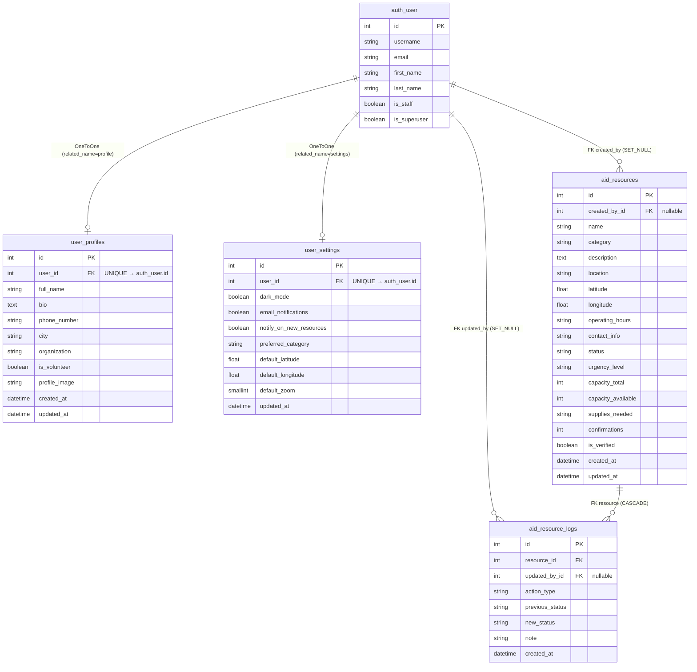

# Architecture & Data Model

## 1. Architecture overview

AyudaMap uses Django's **MVT** pattern with a **vertical-slice** app layout. Each feature app (`home`, `login`, `register`, `profile`, `user_settings`) owns its models, forms, views, URLs, templates, and static assets. Cross-app imports are deliberate and few (for example `register` creates a `Profile` and `UserSettings`; `profile` reads `Resource` and `ResourceStatusLog`).

```
Browser
  │  GET/POST
  ▼
config/urls.py ──► apps.<feature>.urls ──► view
                                            │
                          ┌─────────────────┼──────────────────┐
                          ▼                 ▼                  ▼
                       Form(s)          Model(s)          Template + JSON
                    (validation)     (ORM / database)     (rendered response)
                                            │
                                            ▼
                          Supabase PostgreSQL  (or SQLite in dev)
                                            │
                                  Leaflet + CARTO tiles (browser)
```

### Request flow example — the home map

1. `GET /` → `home:home` ([`apps/home/views.py`](../apps/home/views.py)).
2. `@login_required` redirects anonymous users to `login:login?next=/`.
3. The view reads `q`, `status`, `urgency`, `category` from `request.GET`; if no `category` is given it uses the signed-in user's `settings.preferred_category`.
4. `Resource.objects.filter(is_verified=True).select_related('created_by')` issues a **JOIN** with `auth_user`.
5. Filters and a `map_data` list are built; the latter is serialized into `map_data_json` for the browser.
6. `templates/home/home.html` renders the page; `static/js/home/home.js` reads the JSON, creates the Leaflet map, and draws pins using CARTO tiles.

### App inventory

| App | Responsibility | Models | Key views |
| --- | --- | --- | --- |
| `apps.home` | Resource map, filters, CRUD-ish actions, reports | `Resource`, `ResourceStatusLog` | `home_view`, `add_resource_view`, `confirm_resource_view`, `update_resource_status_view`, `reports_view` |
| `apps.login` | Authentication | — | `login_view`, `logout_view` |
| `apps.register` | Sign-up and related-record creation | — | `register_view` |
| `apps.profile` | User profile + volunteer activity | `Profile` | `profile_view` |
| `apps.user_settings` | Preferences and password change | `UserSettings` | `settings_view` |

`Profile` and `UserSettings` are auto-created for every new `User` by `post_save` signal receivers in their respective `models.py` files; `register_view` also calls `get_or_create` defensively.

### URL map

| Path | Name | Access | Method / purpose |
| --- | --- | --- | --- |
| `/` | `home:landing` | Public | GET — landing page and aid coverage summary |
| `/map/` | `home:map` | Public | GET — read-only aid map |
| `/dashboard/` | `home:dashboard` | Login required | GET — map, ledger, search, filters |
| `/reports/` | `home:reports` | Login required | GET — analytics dashboard |
| `/add/` | `home:add_resource` | Login required | POST — create a resource |
| `/<id>/confirm/` | `home:confirm_resource` | Login required | POST — increment confirmation count |
| `/<id>/status/` | `home:update_status` | Login required | POST — change operating status |
| `/login/` | `login:login` | Public | GET/POST — sign in |
| `/login/logout/` | `login:logout` | Public | GET — sign out |
| `/register/` | `register:register` | Public | GET/POST — create account |
| `/profile/` | `profile:profile` | Login required | GET/POST — edit profile |
| `/settings/` | `user_settings:settings` | Login required | GET/POST — preferences / password |
| `/admin/` | admin | Staff | Django admin site |


---

## 2. Entity-Relationship Diagram



### Relationship summary (for the assignment's "Document Your Table Relationships" step)

| Main table | Related table | Primary key | Foreign key | Relationship |
| --- | --- | --- | --- | --- |
| `aid_resources` | `auth_user` | `aid_resources.id` | `created_by_id → auth_user.id` | Many-to-One (one user submits many resources) |
| `aid_resource_logs` | `aid_resources` | `aid_resource_logs.id` | `resource_id → aid_resources.id` | Many-to-One (one resource has many logs) |
| `aid_resource_logs` | `auth_user` | `aid_resource_logs.id` | `updated_by_id → auth_user.id` | Many-to-One (one user makes many updates) |
| `auth_user` | `user_profiles` | `auth_user.id` | `user_id → auth_user.id` | One-to-One |
| `auth_user` | `user_settings` | `auth_user.id` | `user_id → auth_user.id` | One-to-One |

---

## 3. Data dictionary

### `aid_resources` (`Resource`)

| Field | Type | Default / notes |
| --- | --- | --- |
| `id` | BigAutoField | Primary key |
| `created_by` | FK → User (SET_NULL, nullable) | `related_name='submitted_resources'`; volunteer who submitted the entry |
| `name` | CharField(200) | Required |
| `category` | CharField(50), indexed | `MEDICAL`, `FOOD`, `SHELTER`, `GOV`, `DONATION` |
| `description` | TextField | Optional |
| `location` | CharField(255) | Street address or landmark |
| `latitude` / `longitude` | FloatField | Map pin; defaults `10.3157`, `123.8854` (Cebu) |
| `operating_hours` | CharField(100) | Default `8:00 AM - 5:00 PM` |
| `contact_info` | CharField(100) | Optional |
| `status` | CharField(30), indexed | `OPERATIONAL`, `FULL_CAPACITY`, `TEMPORARILY_CLOSED` |
| `urgency_level` | CharField(20), indexed | `LOW`, `MEDIUM`, `CRITICAL` |
| `capacity_total` | PositiveIntegerField | Default 100 — slots, packs, or beds |
| `capacity_available` | PositiveIntegerField | Default 100 — remaining capacity |
| `supplies_needed` | CharField(255) | Comma-separated urgent items |
| `confirmations` | PositiveIntegerField | Default 1 — community verification count |
| `is_verified` | BooleanField, indexed | Default true; only verified resources appear on the map |
| `created_at` / `updated_at` | DateTimeField | Auto timestamps |

**Computed property:** `occupancy_percentage` = `min(100, round((total - available) / total * 100))`, or `0` when `total <= 0`.

**Indexes:** `(latitude, longitude)`, `(category, is_verified)`, `(urgency_level, status)`; default ordering `-created_at`.

### `aid_resource_logs` (`ResourceStatusLog`)

| Field | Type | Notes |
| --- | --- | --- |
| `id` | BigAutoField | Primary key |
| `resource` | FK → Resource (CASCADE) | `related_name='status_logs'` |
| `updated_by` | FK → User (SET_NULL, nullable) | `related_name='resource_updates'` |
| `action_type` | CharField(30) | `STATUS_UPDATE`, `CONFIRM_ACTIVE`, `SUPPLY_PLEDGE` |
| `previous_status` / `new_status` | CharField(30) | Audit trail of status changes |
| `note` | CharField(255) | Optional human-readable detail |
| `created_at` | DateTimeField | Auto timestamp |

### `user_profiles` (`Profile`)

One-to-one with `auth_user`. Fields: `full_name`, `bio`, `phone_number`, `city`, `organization`, `is_volunteer`, `profile_image` (uploaded to `media/profile/`), `created_at`, `updated_at`.

### `user_settings` (`UserSettings`)

One-to-one with `auth_user`. Fields: `dark_mode`, `email_notifications`, `notify_on_new_resources`, `preferred_category` (`ALL` + the five resource categories), `default_latitude`, `default_longitude`, `default_zoom` (5–18), `updated_at`.

---

## 4. Notable implementation details

- **Atomic confirmation:** `confirm_resource_view` uses `F('confirmations') + 1` in an `update()` to avoid a read-modify-write race.
- **Audit on mutation:** adding a resource, confirming one, or changing status always creates a `ResourceStatusLog`.
- **Status side effect:** setting `FULL_CAPACITY` also zeroes `capacity_available`.
- **Preference-driven default filter:** with no `?category=` parameter, the home view applies `preferred_category` (unless `ALL`).
- **Map data boundary:** the view builds a list of plain dicts and embeds it as JSON in the page; JavaScript handles all pin rendering. Category codes drive pin colours/icons; status drives badge styling.
- **Fresh databases:** Migrations create the schema. Accounts and resources are added through the app or Django admin.
