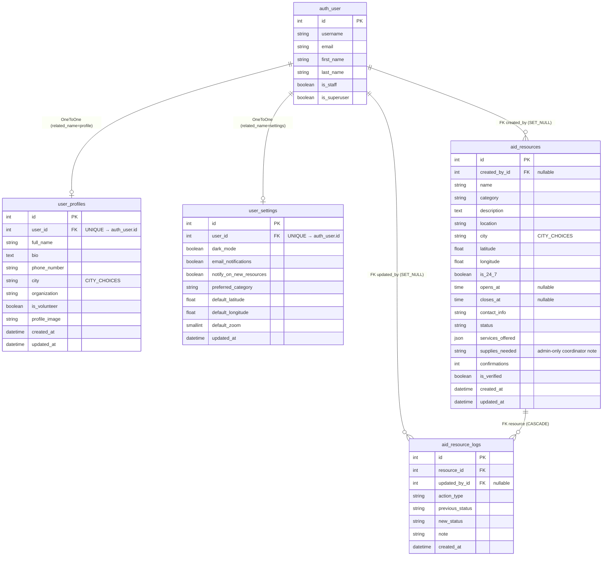

# Architecture & Data Model

## 1. Architecture overview

AyudaMap uses Django's **MVT** pattern with a **vertical-slice** app layout. Each feature app (`home`, `login`, `register`, `profile`, `user_settings`) owns its models, forms, views, URLs, templates, and static assets, while [`apps/locations.py`](../apps/locations.py) provides shared PSGC-aligned Philippine city/municipality choices and normalization. Cross-app imports are deliberate and few (for example `register` updates `Profile` and `UserSettings`; `profile` reads `Resource` and `ResourceStatusLog`; `home` queries `Profile` for the local-volunteer filter).

```
Browser
  │  GET/POST (plus X-Dashboard-Filters AJAX requests on /dashboard/)
  ▼
config/urls.py ──► apps.<feature>.urls ──► view
                                            │
                          ┌─────────────────┼──────────────────┐
                          ▼                 ▼                  ▼
                       Form(s)          Model(s)          Template / JSON
                    (validation)     (ORM / database)     (SSR HTML / partial)
                                            │
                                            ▼
                          Supabase PostgreSQL  (or SQLite in dev)
                                            │
                                  Leaflet + CARTO / OSM tiles (browser)
```

### Request flow examples

#### Public landing & map (`/` and `/map/`)
1. `GET /` → `landing_view` ([`apps/home/views.py`](../apps/home/views.py)) aggregates verified safe havens (`is_verified=True`), open counts via `Resource.objects.currently_open()`, city coverage, category breakdowns, and a `featured_hub` card for [`templates/home/landing.html`](../templates/home/landing.html).
2. `GET /map/` → `map_view` queries `Resource.objects.filter(is_verified=True).select_related('created_by', 'created_by__profile')` (a **JOIN** across `aid_resources`, `auth_user`, and `user_profiles`), serializes non-sensitive pin data with `json_script`, and lets [`static/js/home/map.js`](../static/js/home/map.js) filter pins, open hub details, and render CARTO/OSM tiles client-side.

#### Volunteer dashboard (`/dashboard/`)
1. `GET /dashboard/` → `dashboard_view` is protected by `@login_required` and decorated with `@vary_on_headers("X-Dashboard-Filters")`.
2. It reads `status`, `local_volunteers`, and `category` from `request.GET` (defaulting `category` to the signed-in user's `settings.preferred_category` unless `'ALL'`).
3. `Resource.objects.filter(is_verified=True).select_related('created_by', 'created_by__profile')` filters by category, effective operating status (`filter_by_effective_status`, accounting for `Asia/Manila` operating hours), and optionally `local_volunteers` (a `Subquery` against `Profile`).
4. Normal requests render [`templates/home/home.html`](../templates/home/home.html); in-place filter updates send `X-Dashboard-Filters: 1` and receive a JSON payload containing the `#dashboard-results` template partial HTML, updated `map_data`, and live counts.

### App inventory

| App / Module | Responsibility | Models | Key views / exports |
| --- | --- | --- | --- |
| `apps.home` | Landing, public map, volunteer dashboard, CRUD-ish actions, reports | `Resource`, `ResourceStatusLog` | `landing_view`, `map_view`, `dashboard_view` (`home_view` alias), `add_resource_view`, `confirm_resource_view`, `update_resource_status_view`, `reports_view` |
| `apps.login` | Authentication | — | `login_view`, `logout_view` |
| `apps.register` | Volunteer sign-up and profile/settings setup | — | `register_view` |
| `apps.profile` | User profile (`label = 'user_profile'`) + volunteer activity | `Profile` | `profile_view` |
| `apps.user_settings` | Preferences, map defaults, and password change | `UserSettings` | `settings_view` |
| `apps.locations` | Canonical Philippine city choices & normalizer | — | `CITY_GROUPS`, `CITY_CHOICES`, `REQUIRED_CITY_CHOICES`, `OPTIONAL_CITY_CHOICES`, `normalize_city` |

`Profile` and `UserSettings` are auto-created for every new `User` by `post_save` signal receivers in their respective `models.py` files; `register_view` also calls `get_or_create` defensively and marks new registrants as `is_volunteer=True`.

### URL map

| Path | Name | Access | Method / purpose |
| --- | --- | --- | --- |
| `/` | `home:landing` | Public | GET — landing page and live relief coverage summary |
| `/map/` | `home:map` | Public | GET — read-only full-viewport aid map |
| `/dashboard/` | `home:dashboard` | Login required | GET — volunteer map workbench, filterable ledger, and add modal |
| `/reports/` | `home:reports` | Login required | GET — analytics by city, service, category, and recent audit log |
| `/add/` | `home:add_resource` | Login required | POST — create a verified aid hub and initial audit log |
| `/<id>/confirm/` | `home:confirm_resource` | Login required | POST — atomically increment confirmation count and log activity |
| `/<id>/status/` | `home:update_status` | Login required | POST — change operating status (`OPERATIONAL`, `LIMITED`, `CLOSED`) |
| `/login/` | `login:login` | Public | GET/POST — sign in |
| `/login/logout/` | `login:logout` | Public | GET — sign out |
| `/register/` | `register:register` | Public | GET/POST — create volunteer account |
| `/profile/` | `profile:profile` | Login required | GET/POST — edit profile, view submitted hubs and field logs |
| `/settings/` | `user_settings:settings` | Login required | GET/POST — preferences, map defaults, and password change |
| `/admin/` | admin | Staff | Django admin site (`Resource` and `ResourceStatusLog`) |

---

## 2. Entity-Relationship Diagram



### Relationship summary

| Main table | Related table | Primary key | Foreign key | Relationship |
| --- | --- | --- | --- | --- |
| `aid_resources` | `auth_user` | `aid_resources.id` | `created_by_id → auth_user.id` | Many-to-One (one user submits many resources) |
| `aid_resource_logs` | `aid_resources` | `aid_resource_logs.id` | `resource_id → aid_resources.id` | Many-to-One (one resource has many logs) |
| `aid_resource_logs` | `auth_user` | `aid_resource_logs.id` | `updated_by_id → auth_user.id` | Many-to-One (one user makes many updates) |
| `auth_user` | `user_profiles` | `auth_user.id` | `user_id → auth_user.id` | One-to-One |
| `auth_user` | `user_settings` | `auth_user.id` | `user_id → auth_user.id` | One-to-One |

---

## 3. Data dictionary

### `aid_resources` (`Resource`)

| Field | Type | Default / notes |
| --- | --- | --- |
| `id` | BigAutoField | Primary key |
| `created_by` | FK → User (`SET_NULL`, nullable) | `related_name='submitted_resources'`; volunteer who submitted the entry |
| `name` | CharField(200) | Required |
| `category` | CharField(50), indexed | `MEDICAL`, `FOOD`, `SHELTER`, `GOV`, `DONATION` |
| `description` | TextField | Optional |
| `location` | CharField(255) | Street address, barangay, or landmark |
| `city` | CharField(100), indexed | Canonical city/municipality from `apps.locations.CITY_CHOICES` (default `''` for legacy rows) |
| `latitude` / `longitude` | FloatField | Map pin; defaults `10.3157`, `123.8854` (Cebu) |
| `is_24_7` | BooleanField | Default `False`; when `True`, the hub never auto-closes after hours |
| `opens_at` / `closes_at` | TimeField (nullable) | Defaults `08:00` / `17:00` (`Asia/Manila`); `ResourceForm` clears both when `is_24_7` is checked |
| `contact_info` | CharField(100) | Optional |
| `status` | CharField(30), indexed | `OPERATIONAL` (Operational / Open), `LIMITED` (Crowded / Limited), `CLOSED` (Closed) |
| `services_offered` | JSONField | List of service codes from `SERVICE_CHOICES`: `SHELTER`, `WATER`, `FOOD`, `MEDICAL`, `POWER`, `WIFI`, `PWD`, `PET_FRIENDLY` |
| `supplies_needed` | CharField(255) | Internal coordinator note (Django admin only; never exposed on `/map/` or `/dashboard/`) |
| `confirmations` | PositiveIntegerField | Default `1` — community verification count |
| `is_verified` | BooleanField, indexed | Default `True`; only verified resources appear publicly and in dashboard/reports |
| `created_at` / `updated_at` | DateTimeField | Auto timestamps |

**Computed properties & manager methods (`ResourceQuerySet`):**
- `display_location` — formats `location` and `city` without duplicating the city name if already present in `location`.
- `is_within_operating_hours(now=None)` — checks current `Asia/Manila` time against `opens_at` and `closes_at` (including overnight windows such as `18:00`–`06:00`).
- `is_auto_closed` / `effective_status` / `effective_status_display` — treats non-24/7 centers outside operating hours as `CLOSED` without overwriting the stored `status`.
- `operating_hours_display` / `opens_at_display` / `service_labels` — formatted 12-hour hours and human-readable service labels.
- `Resource.objects.currently_open()` & `filter_by_effective_status(status)` — database-level `Q` queries matching `effective_status`.

**Validation (`Resource.clean()`):** Requires both `opens_at` and `closes_at` with distinct times when `is_24_7=False`, and validates `services_offered` entries against `SERVICE_CHOICES`.

**Indexes:** `(latitude, longitude)`, `(category, is_verified)`; default ordering `-created_at`.

### `aid_resource_logs` (`ResourceStatusLog`)

| Field | Type | Notes |
| --- | --- | --- |
| `id` | BigAutoField | Primary key |
| `resource` | FK → Resource (`CASCADE`) | `related_name='status_logs'` |
| `updated_by` | FK → User (`SET_NULL`, nullable) | `related_name='resource_updates'` |
| `action_type` | CharField(30) | `STATUS_UPDATE`, `CONFIRM_ACTIVE`, `SUPPLY_PLEDGE` |
| `previous_status` / `new_status` | CharField(30) | Audit trail of status changes |
| `note` | CharField(255) | Optional human-readable detail |
| `created_at` | DateTimeField | Auto timestamp |

### `user_profiles` (`Profile`)

One-to-one with `auth_user`. Fields: `full_name`, `bio`, `phone_number`, `city` (`CITY_CHOICES`), `organization`, `is_volunteer`, `profile_image` (uploaded to `media/profile/`), `created_at`, `updated_at`.

### `user_settings` (`UserSettings`)

One-to-one with `auth_user`. Fields: `dark_mode`, `email_notifications`, `notify_on_new_resources`, `preferred_category` (`ALL` + the five resource categories), `default_latitude`, `default_longitude`, `default_zoom` (5–18), `updated_at`.

---

## 4. Notable implementation details

- **Atomic confirmation:** `confirm_resource_view` uses `F('confirmations') + 1` in an `update()` to avoid a read-modify-write race.
- **Audit on mutation:** Adding a resource, confirming one, or changing its status always creates a `ResourceStatusLog`.
- **Automatic after-hours closing:** Centers outside their `opens_at`–`closes_at` window automatically report `Closed` (`effective_status == 'CLOSED'`) and are excluded from `currently_open()` counts on Landing and Reports.
- **Canonical city filtering:** `Profile.city` and `Resource.city` share PSGC-aligned Philippine city choices (`apps/locations.py`), while the **Local volunteers** `Subquery` uses `city__iexact` with legacy `location` fallback for consistent matching.
- **Map data & privacy boundary:** Views serialize safe, non-admin fields into `json_script` blocks (`publicMapDataJson`, `mapDataJson`); `supplies_needed` remains internal to Django admin.
- **Fresh databases:** Migrations create the schema (`apps/home` `0001`–`0005`, `apps/profile` `0001`–`0002`, `apps/user_settings` `0001`–`0003`). Accounts and resources are added through the app or Django admin.
